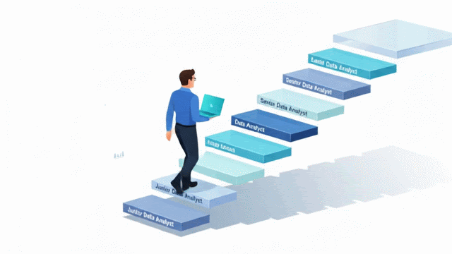
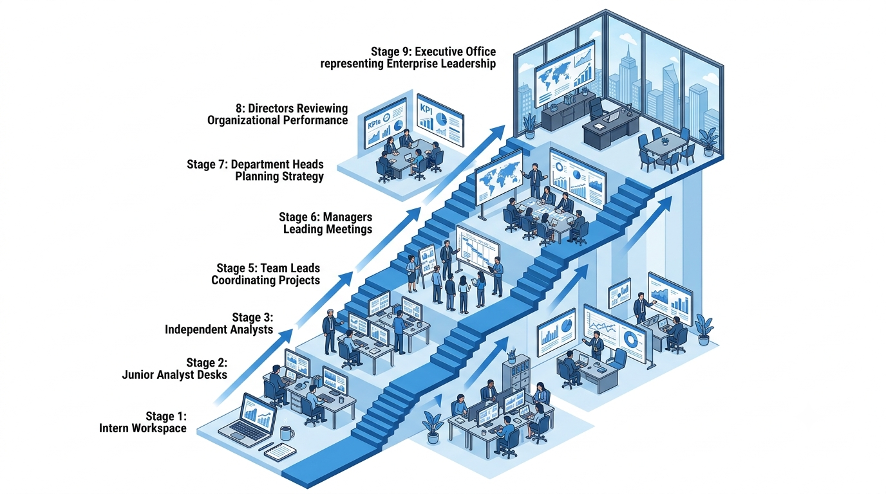
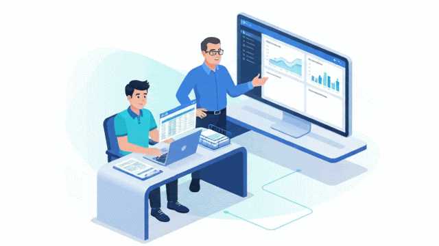
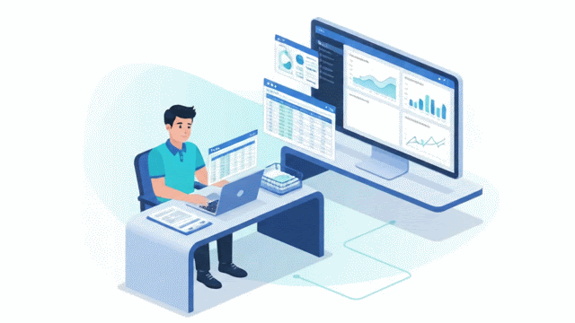
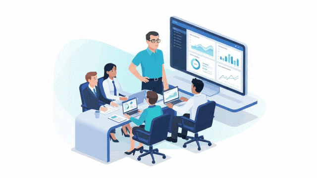
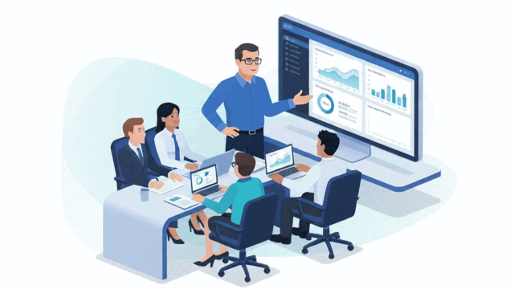
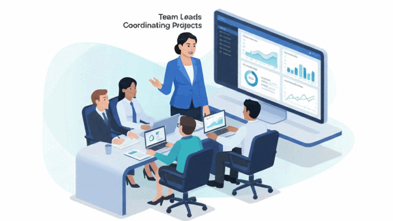
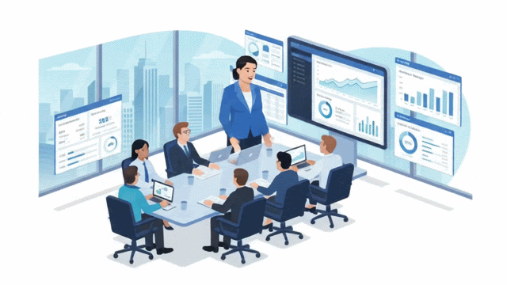
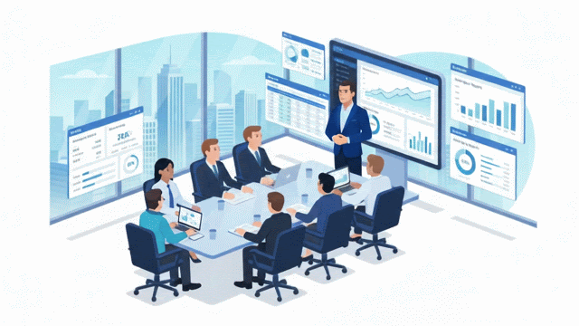

# Data Analyst Career Growth Path (Junior → Senior)

Every Data Analyst starts with the same goal—to build a successful career. However, not everyone follows the same path. Some professionals remain in the same role for years, while others steadily progress into senior and leadership positions.

The difference isn't simply the number of years they've worked. Career growth comes from taking on greater responsibility, making better business decisions, communicating effectively, and creating measurable impact.

This guide explains how a Data Analyst's career typically progresses from a Junior Analyst to senior leadership roles, what each position involves, and how responsibilities evolve over time.

---

## The Typical Data Analytics Career Ladder

Although job titles vary between organizations, the career path usually looks like this:

1. Data Analytics Intern *(Optional)*
2. Junior Data Analyst
3. Data Analyst
4. Senior Data Analyst
5. Lead Data Analyst
6. Analytics Manager
7. Head of Analytics
8. Director of Analytics
9. Vice President of Analytics
10. Chief Data Officer (CDO)

As you move up the ladder, your focus gradually shifts:

- From **executing tasks** to **solving business problems**
- From **working independently** to **leading others**
- From **analyzing data** to **driving business strategy**

---

## Stage 1: Data Analytics Intern (Optional)

An internship is often the first opportunity to experience how analytics works in a real business environment. It provides hands-on exposure to real datasets, reporting processes, and collaboration with experienced analysts.

### Primary Focus

Learning how analytics teams operate.

### Typical Responsibilities

- Assist with data cleaning
- Support report preparation
- Update existing dashboards
- Document processes
- Learn business terminology
- Observe senior analysts

### Success Looks Like

- Learns quickly
- Shows curiosity
- Accepts feedback
- Completes assigned work accurately

---

## Stage 2: Junior Data Analyst

A Junior Data Analyst focuses on building strong analytical foundations while supporting senior team members. At this stage, the emphasis is on learning, accuracy, and consistency.

### Primary Focus

Learning and execution.

### Typical Responsibilities

- Clean and prepare data
- Create recurring reports
- Build and maintain dashboards
- Validate data accuracy
- Answer routine business requests
- Assist experienced analysts

### Success Looks Like

A successful Junior Analyst:

- Produces accurate work
- Learns from feedback
- Completes tasks independently
- Understands business requirements
- Builds trust through consistency

At this level, you're expected to execute tasks reliably rather than make major business decisions.

---

## Stage 3: Data Analyst

The transition from Junior Data Analyst to Data Analyst marks an important milestone. Instead of simply completing assigned work, you're expected to own analytical projects from start to finish.

### Primary Focus

Independent problem solving.

### Typical Responsibilities

- Own complete analytical tasks
- Identify trends and patterns
- Design reports and dashboards
- Present insights to stakeholders
- Recommend process improvements
- Collaborate across departments

### Success Looks Like

A successful Data Analyst:

- Solves business problems independently
- Delivers reliable insights
- Builds strong relationships with stakeholders
- Requires minimal supervision
- Understands how analytics supports business goals

The biggest change at this stage is ownership. Managers begin trusting you to deliver results without constant guidance.

---

## Stage 4: Senior Data Analyst

Senior Data Analysts do much more than analyze data. They influence decisions, guide teammates, and help shape the organization's analytical direction.

### Primary Focus

Creating business impact.

### Typical Responsibilities

- Lead end-to-end analytics projects
- Mentor junior analysts
- Review analytical work
- Improve reporting processes
- Present insights to senior leadership
- Translate business questions into analytical solutions

### Success Looks Like

A successful Senior Data Analyst:

- Is trusted with high-impact projects
- Influences business decisions
- Coaches junior team members
- Solves complex business challenges
- Acts as a subject matter expert

At this stage, people value your judgment as much as your technical ability.

---

## Stage 5: Lead Data Analyst

Lead Data Analysts bridge the gap between technical teams and management. While they still work with data, a significant part of their role involves guiding the team's direction.

### Primary Focus

Technical leadership.

### Typical Responsibilities

- Lead analytics initiatives
- Coordinate multiple analysts
- Review deliverables
- Establish reporting standards
- Improve team workflows
- Support project planning

### Success Looks Like

A successful Lead Analyst:

- Helps the team deliver consistently
- Maintains quality standards
- Solves technical challenges
- Supports both analysts and managers
- Ensures projects stay on track

Leadership at this stage comes through influence rather than authority.

---

## Stage 6: Analytics Manager

The Analytics Manager shifts focus from individual contributions to team performance. Their success depends on enabling others to succeed.

### Primary Focus

People management.

### Typical Responsibilities

- Manage analytics teams
- Hire and mentor analysts
- Allocate resources
- Prioritize projects
- Conduct performance reviews
- Collaborate with business leaders

### Success Looks Like

A successful Analytics Manager:

- Builds a high-performing team
- Delivers projects on time
- Develops future leaders
- Creates efficient processes
- Aligns analytics with business priorities

---

## Stage 7: Head of Analytics

The Head of Analytics oversees the organization's analytics function and ensures data supports long-term business objectives.

### Primary Focus

Department strategy.

### Typical Responsibilities

- Define analytics vision
- Build analytics teams
- Manage budgets
- Establish best practices
- Align analytics initiatives with company goals
- Report to executive leadership

Success at this level is measured by the performance and strategic value of the entire analytics department.

---

## Stage 8: Director of Analytics

The Director of Analytics oversees multiple analytics teams and ensures that analytical initiatives contribute directly to business growth.

### Primary Focus

Organizational leadership.

### Typical Responsibilities

- Define long-term analytics strategy
- Lead multiple managers and teams
- Drive cross-functional initiatives
- Improve organizational decision-making
- Build a data-driven culture

Directors focus less on performing analysis and more on ensuring analytics delivers measurable business value.

---

## Stage 9: Vice President of Analytics

The Vice President of Analytics works closely with executive leadership to shape company-wide decisions using data.

### Primary Focus

Executive leadership.

### Typical Responsibilities

- Define enterprise analytics strategy
- Manage large analytics organizations
- Drive innovation
- Align analytics with business objectives
- Influence executive decision-making

---

## Stage 10: Chief Data Officer (CDO)

The Chief Data Officer is responsible for the organization's overall data strategy. This executive role ensures that data becomes a strategic asset across every department.

### Primary Focus

Enterprise data vision.

### Typical Responsibilities

- Develop company-wide data strategy
- Oversee governance and compliance
- Promote data-driven decision-making
- Lead digital transformation initiatives
- Represent data strategy at the executive level

---

## How Responsibilities Change as You Grow

| Career Stage | Primary Focus |
|--------------|---------------|
| Intern | Learning |
| Junior Data Analyst | Execution |
| Data Analyst | Ownership |
| Senior Data Analyst | Business Impact |
| Lead Data Analyst | Technical Leadership |
| Analytics Manager | People Leadership |
| Head of Analytics | Department Strategy |
| Director / VP | Organizational Leadership |
| Chief Data Officer | Enterprise Vision |

One pattern becomes clear: every promotion brings greater responsibility. Technical expertise remains important, but communication, business understanding, leadership, and strategic thinking become increasingly valuable as your career progresses.

---

## Key Takeaways

- Career growth is driven by impact, not just years of experience.
- Every promotion increases your level of ownership and responsibility.
- Technical skills help you enter the field, while business understanding and communication help you advance.
- Leadership begins long before you become a manager.
- The most successful analysts continuously adapt, learn, and contribute to better business decisions.

---

## Conclusion

A successful Data Analytics career is a journey of continuous growth. As you move from Junior Data Analyst to senior leadership roles, your responsibilities evolve from completing tasks to influencing decisions, guiding teams, and shaping business strategy.

Understanding this progression helps you prepare for the next step in your career. Rather than focusing only on your current role, think about the expectations of the role you want next. Developing the mindset, responsibility, and business impact required at each stage will put you in the strongest position for long-term success.