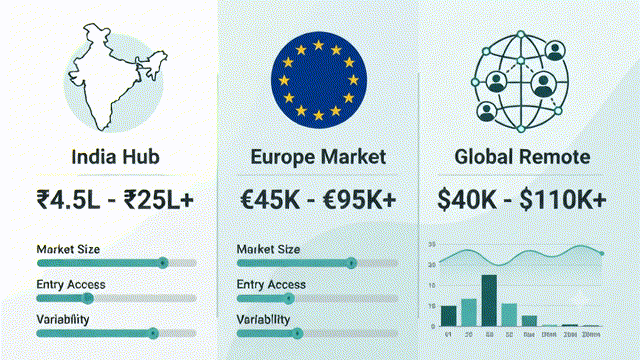
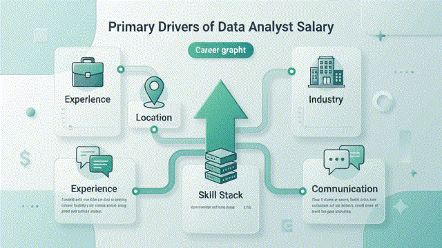

---

title: "Data Analyst Salary in India vs Europe vs Remote: What to Expect in 2026"

date: "2026-10-29"

category: "Career"

thumbnail: "./thumbnail.png"

description: "A practical, beginner-friendly guide to data analyst salaries in India, Europe, and remote roles, with real examples, pay drivers, negotiation tips, and career strategy."

---

# Data Analyst Salary in India vs Europe vs Remote: What to Expect in 2026

A data analyst salary can look wildly different depending on where you work, who pays you, and how your company defines **"remote."**

That is why two people with the same title can earn completely different salaries. One may be in India at an early-career service company. Another may be in Berlin at a product company. A third may work remotely for a global employer that pays by location, not by title.

The honest answer is simple:

> **There is no single data analyst salary. There are salary markets, and each market rewards different skills, experience levels, and business models.**

---

## The Salary Story in One Line

- **India** offers one of the easiest entry points into Data Analytics.

- **Europe** generally pays higher salaries, but every country has its own market.

- **Remote jobs** can pay anywhere from local salaries to global salaries depending on the employer.

---

## What Actually Decides a Data Analyst Salary?

### 1. Experience

#### Simple Explanation

The more experience you have, the more valuable you become.

#### Professional Explanation

Companies pay for the complexity of problems you can solve, not just the number of years you've worked.

#### Real-World Example

A fresher might spend the day creating reports.

A Senior Data Analyst may help executives decide whether the company should invest millions into a new market.

---

### 2. Location

#### Simple Explanation

Different countries pay differently.

#### Professional Explanation

Companies create salary bands based on local job markets, taxes, demand, and cost of living.

#### Real-World Example

A Data Analyst in Mumbai and one in Amsterdam may perform similar work but receive very different salaries.

---

### 3. Industry

Some industries rely heavily on data.

These usually pay more.

Examples include:

- Finance

- Healthcare

- SaaS

- E-commerce

- Artificial Intelligence

- Consulting

---

### 4. Skills

The more business problems you can solve, the higher your salary becomes.

Instead of learning dozens of tools, master the fundamentals:

- Excel

- SQL

- Power BI

- Python

- Statistics

- Data Visualization

- Business Communication

---

### 5. Communication Skills

Many beginners ignore this.

Companies don't pay you to make charts.

They pay you to help people make better decisions.

Think of yourself as a translator between **business** and **data**.

---

# India vs Europe vs Remote

---

## India

Current salary surveys show that:

- Average salary is around **₹5.8–8 LPA**

- Product companies generally pay more than service companies.

- Metro cities usually offer higher salaries.

### Best Cities

- Bangalore

- Hyderabad

- Pune

- Mumbai

- Gurgaon

### Pros

- Easier entry

- Large number of openings

- Growing analytics market

### Cons

- Higher competition

- Lower salaries compared to Europe

---

## Europe

Europe is **not one market.**

Every country has different salaries.

Examples:

- Germany

- Netherlands

- Spain

- France

- United Kingdom

Generally,

Western Europe pays significantly more than Eastern Europe.

### Pros

- Better work-life balance

- Higher salaries

- Strong employee benefits

### Cons

- Visa requirements

- Higher taxes

- Language barriers in some countries

---

## Remote Jobs

Remote does **not** automatically mean high salary.

Some companies pay based on:

- Your location

- Company's headquarters

- Global salary bands

This means:

Two remote employees doing identical work may earn completely different salaries.

---

# Estimated Salary Comparison

| Experience | India | Europe | Remote |
|------------|--------|---------|---------|
| Fresher | ₹4–8 LPA | €35k–50k | Depends on employer |
| 2–5 Years | ₹8–18 LPA | €50k–70k | Often higher |
| 5+ Years | ₹18–35+ LPA | €70k–100k+ | Can exceed local salaries |

> **Note:** Salaries vary depending on company, city, skills, and industry.

---

# Why Two Data Analysts Earn Different Salaries

Even with the same title, analysts may perform very different work.

For example:

### Analyst A

- Creates Excel reports

- Updates dashboards

- Runs SQL queries

### Analyst B

- Predicts customer churn

- Builds forecasting models

- Advises executives

- Helps increase company revenue

Analyst B creates more business value.

Therefore, Analyst B earns more.

---

# Think of Salary Like a Ladder

### Level 1

I know the tools.

### Level 2

I can use the tools independently.

### Level 3

I solve business problems.

### Level 4

I help companies make strategic decisions.

Every step increases your market value.

---

# Did You Know?

> Most companies don't hire Data Analysts to create dashboards.

They hire them to answer questions that help businesses make more money or reduce costs.

---

# Myth vs Fact

### Myth

Remote jobs always pay more.

### Fact

Remote salaries depend entirely on the employer's compensation policy.

---

### Myth

Europe pays the same everywhere.

### Fact

Germany, Spain, Netherlands, France, and the UK all have different salary markets.

---

### Myth

Certificates guarantee high salaries.

### Fact

A strong portfolio often has a bigger impact than certificates alone.

---

# How to Increase Your Salary Faster

## Master the Fundamentals

Don't rush into AI.

Master:

- Excel

- SQL

- Power BI

- Python

---

## Build Projects

Employers trust projects more than certificates.

Examples:

- Sales Dashboard

- Customer Churn Analysis

- Marketing Dashboard

- Financial Dashboard

---

## Learn Business

Instead of saying:

> "I created a dashboard."

Say:

> "I reduced reporting time by 80%."

Business impact increases salary.

---

## Improve Communication

A great analyst explains complicated ideas simply.

The best analysts are also great storytellers.

---

## Choose the Right Market

Your career goal determines your best option.

If you want:

- Fast entry → India

- Higher salaries → Europe

- Flexibility → Remote

---

# Common Mistakes

❌ Learning too many tools

❌ Ignoring SQL

❌ Building no portfolio

❌ Comparing salaries without considering cost of living

❌ Expecting remote jobs to pay international salaries automatically

---

# Quick Summary

| Goal | Best Choice |
|-------|-------------|
| First Job | India |
| Higher Local Salary | Europe |
| Flexible Work | Remote |
| Faster Growth | Product Companies |
| Better Long-Term Career | Strong Portfolio + Business Skills |

---

# Frequently Asked Questions

## What is a good Data Analyst salary in India?

For freshers, around ₹4–8 LPA is common, while experienced analysts can earn significantly more depending on skills and company.

---

## Which European country pays Data Analysts the most?

Countries such as Germany, the Netherlands, Switzerland, and the United Kingdom generally offer competitive salaries, though cost of living also differs.

---

## Are remote jobs better?

They can be, but salary depends on the employer's compensation strategy.

---

## Can freshers get remote jobs?

Yes, but competition is global.

A strong portfolio is essential.

---

## What matters more than a degree?

Practical skills.

Recruiters often value projects, internships, and business understanding more than academic qualifications.

---

# Key Takeaways

- There is no universal Data Analyst salary.

- Skills matter more than job titles.

- Europe is not one salary market.

- Remote work is a work model, not a salary guarantee.

- Business impact drives long-term salary growth.

- Communication is a hidden career advantage.

- Building a strong portfolio is one of the fastest ways to increase earning potential.

---

# Conclusion

Instead of asking,

> **"What is the salary of a Data Analyst?"**

Ask,

> **"Which market is paying me, for what value, and under what compensation model?"**

That one change in thinking will help you make smarter career decisions.

Whether you begin in India, relocate to Europe, or work remotely for a global company, your salary will ultimately depend on the value you create—not just the title on your LinkedIn profile.

