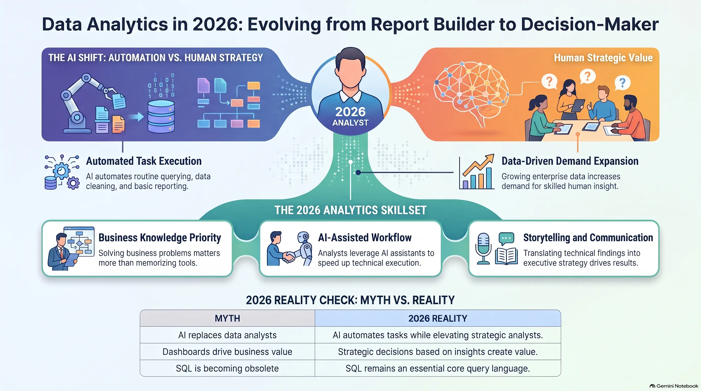
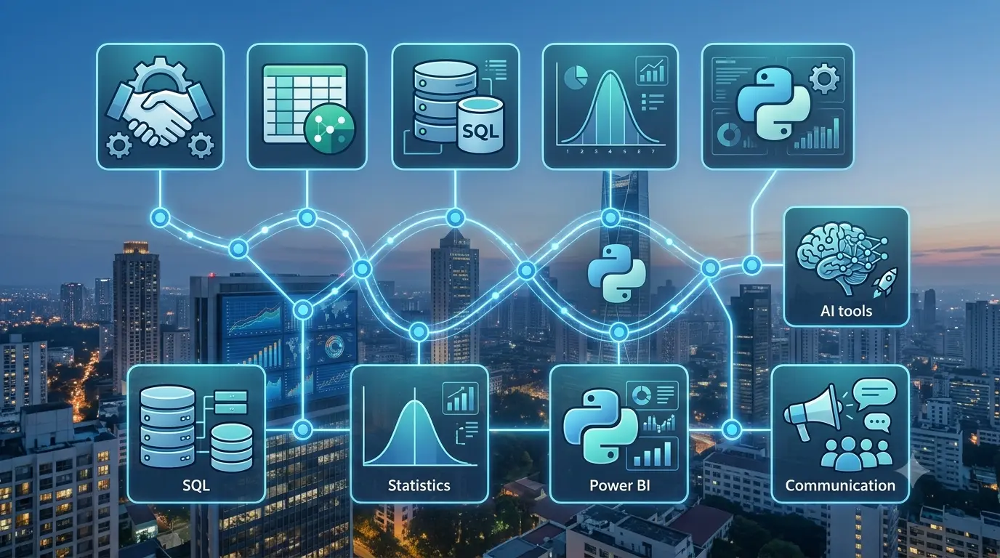
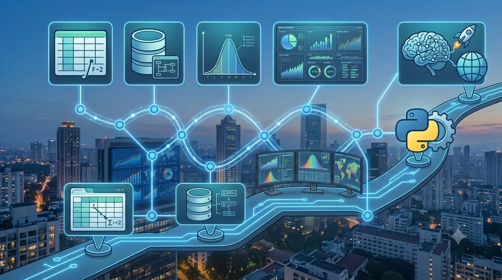

# Is Data Analytics Still Worth Learning in 2026? The Complete Beginner-to-Pro Guide

Imagine spending six months learning SQL, Python, Excel, and Power BI.

You build projects.

You earn certifications.

Then one day you open YouTube and see dozens of videos saying:

> "AI has replaced Data Analysts."

Another creator says:

> "Nobody is hiring freshers anymore."

Then another claims:

> "Learn Prompt Engineering instead."

If you're confused, you're not alone.

Thousands of students, career switchers, and even experienced professionals are asking the same question:

**Is Data Analytics still worth learning in 2026?**

The short answer is:

> **Yes—but not in the same way it was five years ago.**

The role hasn't disappeared.

It has evolved.

The people who learn modern analytics with AI will have opportunities.

The people who learn outdated skills hoping to get a job simply because they know Excel may struggle.

This article explains what actually changed, what employers want in 2026, and whether Data Analytics is still one of the smartest careers you can choose.

---

## Quick Answer

If you only remember one thing from this article, remember this:

> **Data Analytics is not dying. Basic data work is becoming automated, while skilled analysts who can combine business knowledge, SQL, visualization, statistics, and AI are becoming more valuable.** 

---

## Who Should Read This Guide?

This guide is for:

- Students choosing a career
- Fresh graduates
- Working professionals switching careers
- Software developers interested in analytics
- Business professionals
- Managers who want to understand AI's impact
- Anyone wondering if it's too late to start

No prior knowledge is required.

We'll explain every concept from beginner level before moving to advanced ideas.

---

## Why Is Everyone Suddenly Asking This Question?

Five years ago, the answer was simple.

Companies were collecting more data than ever before.

Every business needed analysts.

Learning SQL and Power BI almost guaranteed interview opportunities.

Then everything changed.

Artificial Intelligence entered the workplace.

Tools like ChatGPT, Microsoft Copilot, Claude, Gemini, and countless AI-powered Business Intelligence platforms started writing SQL queries, generating charts, explaining dashboards, and even summarizing reports.

Naturally, people started asking:

> "If AI can analyze data, why would companies hire analysts?"

It's a reasonable question.

But it's also based on a misunderstanding of what professional data analysts actually do.

---

## What Actually Does a Data Analyst Do?

### Simple Explanation

A Data Analyst helps businesses make better decisions using data.

That's it.

Everything else is just a way to achieve that goal.

---

### Professional Explanation

A Data Analyst collects, cleans, transforms, analyzes, visualizes, and communicates data to answer business questions and support strategic decision-making.

Their job isn't simply creating dashboards.

Their job is helping organizations make better decisions.

---

### Real-World Example

Imagine a hospital notices that patient waiting times increased from 20 minutes to 65 minutes.

The hospital director doesn't need another dashboard.

They need answers.

A Data Analyst investigates:

- Which department is causing delays?
- Which days are busiest?
- Are specific doctors overloaded?
- Is staffing sufficient?
- What changes will reduce waiting time?

The dashboard is only one part of solving the problem.

The real value comes from understanding *why* something happened and recommending *what to do next*.

---

## Did You Know?

> Many executives don't ask for "more data."

> They ask for **better decisions.**

That's why companies pay analysts.

---

## Data Is Like a Treasure Map

Imagine someone gives you a treasure map.

You don't become rich simply because you own the map.

You still have to:

- understand it
- identify landmarks
- avoid traps
- choose the best path

Business data works exactly the same way.

Companies already have enormous amounts of data.

Their biggest challenge isn't collecting more.

It's understanding what the data means.

That is where skilled analysts create value.

---

## So... Is AI Replacing Data Analysts?

This is the question everyone really wants answered.

The honest answer is:

> **AI is replacing tasks—not the entire profession.** 

That distinction matters.

---

### Think About Calculators

When calculators became popular, people predicted accountants would disappear.

Instead:

- accountants became faster
- businesses hired more accountants
- accountants focused on financial strategy instead of manual calculations

The same thing is happening with AI.

---

### AI Can Already Do Things Like

- write SQL
- generate charts
- summarize reports
- clean datasets
- explain formulas
- build simple dashboards
- automate repetitive work

These are valuable capabilities.

But notice something.

They're mostly repetitive tasks.

---

### AI Still Struggles With

- understanding business goals
- asking better questions
- communicating with stakeholders
- handling incomplete information
- understanding organizational politics
- making ethical decisions
- influencing executives
- balancing trade-offs between departments

These are human skills.

And they're becoming even more valuable.

---

## Myth vs Fact

| Myth | Fact |
|-------|------|
| AI replaced Data Analysts | AI automates many analyst tasks but increases demand for analysts who can use AI effectively.  |
| Dashboards are enough | Businesses pay for insights, not dashboards. |
| SQL is becoming useless | SQL remains one of the most requested analytics skills.  |
| Excel is dead | Excel is still heavily used across industries. |
| Beginners have no chance | Competition has increased, but practical skills and portfolios matter more than ever.  |

---

## What Actually Changed in 2026?

The biggest change isn't AI.

The biggest change is **expectations.**

A few years ago, employers often hired analysts who could create reports.

Today, many employers expect analysts to:

- use AI productively
- automate repetitive work
- communicate findings clearly
- understand business problems
- work with cloud platforms
- create dashboards that influence decisions

In other words,

The job became more valuable.

But also more demanding. 

---

## A New Kind of Analyst Is Emerging

Modern analysts don't compete against AI.

They work with it.

Instead of spending four hours cleaning spreadsheets, they let AI perform much of the repetitive work.

That gives them more time to:

- understand customers
- discover opportunities
- identify risks
- communicate with stakeholders
- recommend business actions

This is why many companies are no longer looking for people who simply "know Power BI."

They're looking for people who know how to solve business problems using data and AI together. 

---

## Quick Summary

Here's what we've learned so far:

- Data Analytics is still highly relevant.
- AI is changing the role—not eliminating it.
- Repetitive tasks are increasingly automated.
- Human judgment is becoming more valuable.
- Business understanding matters more than tool knowledge.
- The future belongs to analysts who combine technical skills with AI and communication.

---

---

# Is the Data Analytics Job Market Still Growing?

This is probably the most important question after "Is it worth learning?"

Let's answer it with logic before opinions.

Imagine opening a hospital.

Would you rather make decisions based on:

- Guesswork
- Experience alone
- Or actual patient data?

Now replace "hospital" with:

- Amazon
- Netflix
- Zomato
- Reliance
- Tata
- Banks
- Airlines
- Manufacturing companies
- Government departments

The answer doesn't change.

As businesses collect more data every day, they need people who can turn that data into decisions.

That fundamental need hasn't disappeared.

In fact, it has become even more important.

---

## Data Is Growing Faster Than Ever

### Simple Explanation

Every action you take online creates data.

Watching YouTube.

Ordering food.

Using Google Maps.

Shopping online.

Paying through UPI.

Visiting a hospital.

Even walking with your smartwatch.

Businesses don't just collect this data for fun.

They collect it because it helps them improve products, reduce costs, detect fraud, personalize experiences, and make better decisions.

---

### Professional Explanation

Organizations are experiencing exponential data growth from transactional systems, IoT devices, cloud platforms, mobile applications, CRM systems, ERP software, social media, and AI applications.

More data means more opportunities—but only if someone can analyze it correctly.

---

### Real-World Example

Think about Netflix.

Millions of people watch movies every day.

Netflix doesn't simply count views.

It analyzes:

- Which scene made viewers stop watching?
- Which actors attract more viewers?
- Which thumbnail gets more clicks?
- Which genre performs well in each country?
- What should be recommended next?

Every one of those decisions depends on data analytics.

---

## If AI Can Analyze Data, Why Are Companies Still Hiring Analysts?

Here's something many beginners misunderstand.

Companies don't hire analysts because dashboards are difficult to build.

They hire analysts because business problems are difficult to solve.

Imagine your manager asks:

> "Our sales dropped by 18% last quarter. Why?"

There isn't a single button in ChatGPT that magically knows:

- your company's pricing strategy
- your competitors
- your customer behavior
- your seasonal demand
- your inventory issues
- your marketing campaigns

Someone has to investigate.

Someone has to ask better questions.

Someone has to validate the data.

Someone has to communicate the findings.

That "someone" is usually the analyst.

---

## AI Is Becoming Your Assistant—Not Your Replacement

Think of Iron Man.

Tony Stark is brilliant.

His AI assistant, JARVIS, is incredibly powerful.

But JARVIS doesn't decide what problem to solve.

Tony does.

Modern AI tools work the same way.

They can:

- generate SQL queries
- explain Python code
- create Power BI measures
- summarize dashboards
- automate repetitive tasks

But they still depend on human direction.

The better the analyst, the better the AI becomes.

---

> **Did You Know?**
>
> The quality of AI-generated analysis depends heavily on the quality of the question you ask.
>
> Experienced analysts usually ask better questions than beginners.

---

# Which Industries Hire Data Analysts in 2026?

One of the biggest myths is that only technology companies hire analysts.

The reality is very different.

Almost every industry now relies on data.

Here are some of the biggest employers.

---

## Healthcare

Healthcare organizations analyze data to:

- improve patient outcomes
- reduce waiting times
- predict disease risks
- optimize hospital resources
- monitor treatment effectiveness

### Example

A hospital notices emergency room waiting times are increasing.

A Data Analyst identifies that staffing is insufficient between 6 PM and 10 PM.

The hospital adjusts schedules.

Waiting time drops.

No new building was required.

Only better decisions.

---

## Banking and Finance

Banks analyze data for:

- fraud detection
- customer segmentation
- loan approval
- investment analysis
- risk management

Every credit card swipe creates valuable data.

---

## E-commerce

Companies like Amazon and Flipkart analyze:

- customer behavior
- abandoned carts
- pricing
- delivery performance
- inventory
- product recommendations

Without analytics, modern e-commerce wouldn't function efficiently.

---

## Manufacturing

Manufacturers analyze data to:

- reduce machine downtime
- predict equipment failures
- improve quality
- optimize production

This is often called **Predictive Maintenance**.

Instead of fixing machines after they break, companies predict failures before they happen.

---

## Retail

Retail businesses study:

- customer buying patterns
- seasonal demand
- inventory
- store performance
- pricing strategy

Analytics helps stores stock the right products at the right time.

---

## Sports

Modern sports teams use analytics for:

- player performance
- injury prevention
- match strategy
- recruitment
- fitness monitoring

Moneyball, one of the most famous sports stories, showed how data could outperform traditional scouting.

---

## Government

Governments analyze data for:

- transportation planning
- healthcare
- taxation
- public safety
- disaster management
- urban development

Data Analytics isn't only a private-sector skill.

It's becoming a public-sector necessity as well.

---

## Skills Companies Expect in 2026

Many beginners ask,

> "What should I learn?"

The better question is:

> "What problems should I learn to solve?"

Tools change.

Problem-solving doesn't.

Still, employers expect a practical toolkit.

---

## 1. Excel

### Simple Explanation

Excel is still one of the fastest ways to analyze small and medium-sized datasets.

### Professional Explanation

Excel remains widely used for reporting, pivot tables, financial modeling, ad hoc analysis, and business operations.

### Real-World Example

A sales manager receives yesterday's sales report.

Opening Excel is usually faster than importing the data into Python.

---

## 2. SQL

### Simple Explanation

SQL helps you retrieve data from databases.

### Professional Explanation

Structured Query Language (SQL) is the standard language for querying relational databases.

It is one of the most important skills for analysts.

### Real-World Example

Instead of searching millions of customer records manually,

SQL retrieves exactly what you need in seconds.

---

## 3. Power BI or Tableau

Visualization tools help people understand data.

Executives don't want spreadsheets.

They want answers.

Dashboards help communicate those answers clearly.

---

## 4. Statistics

You don't need a PhD.

But you do need to understand:

- averages
- percentages
- distributions
- probability
- correlation
- statistical significance

Without statistics,

it's easy to reach incorrect conclusions.

---

## 5. Business Understanding

This is the skill beginners underestimate the most.

Knowing SQL doesn't automatically tell you why profits dropped.

Understanding the business does.

Always ask:

- What problem are we solving?
- Why does it matter?
- Who will use this analysis?

---

## 6. AI Tools

Modern analysts use AI every day.

Examples include:

- ChatGPT
- Microsoft Copilot
- Claude
- Gemini
- GitHub Copilot

AI should increase your productivity—not replace your thinking.

---

## The Modern Analytics Stack

Think of your skills like building a house.

| Layer | Purpose |
|--------|----------|
| Business Knowledge | Understand the problem |
| Statistics | Make reliable conclusions |
| SQL | Retrieve data |
| Excel | Quick analysis |
| Python | Automation and advanced analysis |
| Power BI / Tableau | Visualization |
| AI | Speed up repetitive work |
| Communication | Influence decisions |

Notice something interesting.

Programming isn't at the top.

Communication is.

Because insights only create value when people understand and act on them.

---

## Common Mistakes Beginners Make

### Mistake #1

Learning tools without solving problems.

---

### Mistake #2

Collecting certificates instead of projects.

---

### Mistake #3

Watching tutorials without practicing.

---

### Mistake #4

Ignoring business knowledge.

---

### Mistake #5

Trying to learn everything at once.

---

## A Better Learning Strategy

Instead of learning like this:

Excel → SQL → Python → Statistics → Power BI → AI

Learn like this:

Business Problem

↓

Data

↓

Excel

↓

SQL

↓

Visualization

↓

Insights

↓

Business Decision

↓

Automation with AI

Every tool should help solve a real problem.

---

## Case Study: A Coffee Shop

Imagine you own a coffee shop.

Sales suddenly drop.

A beginner asks:

> "How do I build a dashboard?"

A good analyst asks:

- Which products declined?
- Which days changed?
- Which store?
- Which customers stopped visiting?
- Did prices increase?
- Did competitors launch promotions?
- Was there bad weather?
- Did inventory run out?

Notice the difference?

The dashboard comes later.

The questions come first.

---

## Quick Summary

Here's what we've learned in this section:

- Companies still need analysts because business problems haven't disappeared.
- AI automates repetitive work but still requires human judgment.
- Every major industry hires Data Analysts.
- Business understanding is often more valuable than another programming language.
- Modern analysts combine technical skills, communication, and AI.

---

---

# Can You Still Build a Successful Career in Data Analytics in 2026?

By now, we've established two important facts:

- Data Analytics isn't dead.
- AI isn't replacing skilled analysts.

But another question remains.

**Is it too late to start?**

If you're a beginner, it might feel like everyone else already knows SQL, Python, Power BI, machine learning, cloud computing, and AI.

The truth is much simpler.

Every year, millions of students graduate.

Thousands switch careers.

Companies launch new products.

Businesses adopt new technologies.

That means new data—and new problems to solve.

There will always be demand for people who can turn data into better decisions.

The challenge isn't finding opportunities.

The challenge is becoming the kind of analyst companies actually want to hire.

---

## Is Data Analytics Oversaturated?

### Simple Explanation

No—but the market for **average** candidates is.

### Professional Explanation

Entry-level competition has increased because learning resources are widely available. However, organizations continue to seek candidates who demonstrate practical problem-solving, business understanding, communication skills, and project experience.

### Real-World Example

Imagine two candidates.

**Candidate A**

- 15 online certificates
- No projects
- Memorized interview answers

**Candidate B**

- 3 strong projects
- Explains business impact
- Uses SQL, Power BI, and AI confidently
- Communicates insights clearly

Who gets the interview?

Almost always, Candidate B.

Companies hire people who can solve problems—not people who collect certificates.

---

## Do Certifications Matter?

Yes—but not in the way many people think.

Certifications help prove that you've learned a topic.

They do **not** prove you can solve real business problems.

Think of a driving license.

It proves you're allowed to drive.

It doesn't prove you're a Formula 1 driver.

The same applies to certifications.

A strong portfolio combined with relevant certifications is far more powerful than certifications alone.

---

## What Should Your Portfolio Include?

Your portfolio should answer one question:

> **"If we hire you, can you solve our business problems?"**

A great beginner portfolio might include:

- Sales dashboard
- Healthcare analytics dashboard
- Customer churn analysis
- Financial performance dashboard
- HR analytics
- Marketing campaign analysis
- Supply chain dashboard

Each project should explain:

1. The business problem
2. The data
3. The analysis
4. The insights
5. The recommendation
6. The business impact

Don't just show charts.

Tell a story.

---

# A Practical Roadmap to Become a Data Analyst

There are many learning paths online.

Some are too complicated.

Others skip important fundamentals.

Here's a practical roadmap that builds skills in the right order.

## Stage 1: Spreadsheet Skills

Learn:

- Excel
- Data cleaning
- Formulas
- Pivot Tables
- Charts
- Basic reporting

Goal:

Become comfortable working with business data.

---

## Stage 2: SQL

Learn:

- SELECT
- WHERE
- GROUP BY
- ORDER BY
- JOINS
- Subqueries
- Common Table Expressions (CTEs)
- Window Functions

Goal:

Retrieve exactly the data you need.

---

## Stage 3: Statistics

Focus on concepts rather than memorizing formulas.

Understand:

- Mean
- Median
- Mode
- Variance
- Standard deviation
- Correlation
- Probability
- Confidence intervals

Goal:

Avoid making incorrect conclusions from data.

---

## Stage 4: Power BI or Tableau

Learn:

- Data modeling
- Relationships
- Dashboard design
- KPIs
- Filters
- Interactive reports
- Storytelling with data

Goal:

Communicate insights effectively.

---

## Stage 5: Python

Learn Python after understanding analytics fundamentals.

Focus on:

- Pandas
- NumPy
- Matplotlib
- Data cleaning
- Automation

Goal:

Handle larger datasets and automate repetitive work.

---

## Stage 6: AI for Analytics

Learn how to use AI responsibly.

Examples include:

- Writing SQL faster
- Debugging Python code
- Explaining formulas
- Brainstorming KPIs
- Summarizing dashboards
- Creating documentation

AI should make you more productive—not replace your understanding.

---

## Stage 7: Business Thinking

This never ends.

Learn about:

- Marketing
- Finance
- Operations
- Healthcare
- Retail
- Manufacturing

The more business you understand,

the more valuable your analysis becomes.

---

## Salary Expectations in 2026

Salary depends on:

- Country
- Experience
- Industry
- Skills
- Portfolio
- Communication
- Company size

Instead of chasing salary,

focus on becoming valuable.

People who consistently solve business problems often see their earning potential grow significantly over time.

---

## What Will the Future Look Like?

Let's look ahead.

### 2026–2030 Trends

Expect analysts to spend less time on:

- manual reporting
- repetitive data cleaning
- writing basic SQL
- creating routine charts

Expect analysts to spend more time on:

- decision-making
- stakeholder communication
- AI supervision
- data storytelling
- experimentation
- strategic planning
- automation design
- ethical AI governance

The analyst of the future looks less like a report builder and more like a business advisor.

---

## Myth vs Fact

| Myth | Fact |
|------|------|
| AI knows everything about your business. | AI only knows the information you provide and still requires human judgment. |
| Python is mandatory for every analyst. | Many analysts use Python daily, but some roles rely primarily on SQL, Excel, and BI tools. |
| You need a Computer Science degree. | Many successful analysts come from business, engineering, healthcare, finance, and other backgrounds. |
| Dashboards create business value. | Decisions based on insights create business value. |
| Learning ends after getting a job. | The best analysts continuously learn new tools, industries, and technologies. |

---

## Common Questions (FAQ)

### Is Data Analytics still worth learning in 2026?

Yes.

The role has evolved, but organizations continue to depend on data-driven decision-making.

---

### Will AI replace Data Analysts?

AI will automate many repetitive tasks.

It is more likely to change how analysts work than eliminate the profession.

---

### Is SQL still worth learning?

Absolutely.

SQL remains one of the core skills for working with structured data.

---

### Should I learn Python?

Yes, especially if you want to automate tasks or work with larger datasets.

However, build a strong foundation in Excel, SQL, and business thinking first.

---

### Can I become a Data Analyst without a degree?

Yes.

Many employers value practical projects, portfolios, communication skills, and problem-solving ability alongside—or sometimes more than—a specific degree.

---

### How long does it take to become job-ready?

It depends on your consistency.

With focused learning, hands-on projects, and regular practice, many learners can build an entry-level portfolio within several months.

---

## Key Takeaways

- Data Analytics is still one of the most valuable business skills in 2026.
- AI is changing workflows, not eliminating the profession.
- Business knowledge is becoming more important than memorizing tools.
- Communication and storytelling are competitive advantages.
- Strong projects outperform long lists of certificates.
- Continuous learning is essential because technology evolves quickly.
- The future belongs to analysts who combine data, business, and AI effectively.

---

## Final Thoughts

Imagine two people starting today.

The first spends months worrying whether AI will replace Data Analysts.

The second spends those same months learning SQL, building projects, understanding business problems, and using AI to become more productive.

One waits for certainty.

The other builds capability.

Five years from now, the difference between them won't be luck.

It will be the decision they made today.

If you're willing to stay curious, solve real problems, communicate clearly, and adapt as technology evolves, Data Analytics remains one of the most rewarding careers you can build.

The tools will change.

The technology will evolve.

But organizations will always need people who can transform information into better decisions.

And that's what great Data Analysts do.

