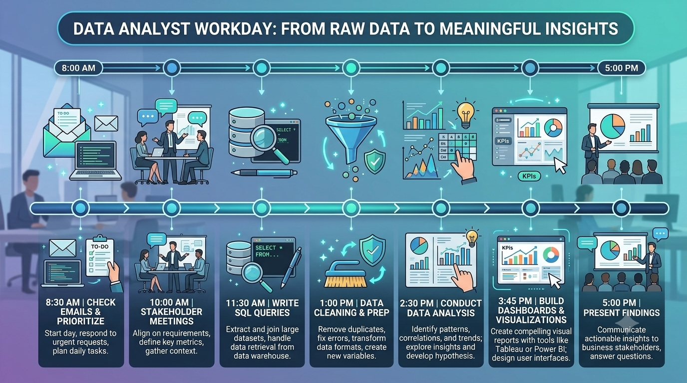

# What Does a Data Analyst Actually Do All Day?


If you've ever searched for **"What does a Data Analyst actually do?"**, you've probably found answers like:

- They analyze data.
- They create dashboards.
- They write SQL queries.
- They use Excel.

Technically, all of these are correct.

But they don't answer the real question.

**What happens between logging into the office in the morning and shutting down the laptop in the evening?**

What occupies those eight or nine hours?

Do analysts spend the whole day writing SQL?

Are they constantly building Power BI dashboards?

Do they attend meetings all day?

Or are they doing something completely different?

By the end of this guide, you'll understand exactly how a Data Analyst spends a typical day, why every task matters, and how each activity helps a business make better decisions.

Whether you're planning to become a Data Analyst or simply curious about the profession, this article will show you what the job really looks like.

---

## Why Businesses Hire Data Analysts


Let's begin with a simple question.

Imagine you own a restaurant.

Every day, hundreds of customers visit.

They order different meals.

Some pay online.

Some pay cash.

Some leave happy.

Some never return.

By the end of the month, you have thousands of rows of information.

But information alone doesn't answer questions like:

- Which dishes earn the highest profit?
- Why are weekend sales dropping?
- Which customers are most loyal?
- Which branch performs the best?
- Are discounts actually increasing revenue?

This is where a Data Analyst comes in.

### Simple Explanation

A Data Analyst turns raw data into useful information that helps businesses make smarter decisions.

### Professional Explanation

A Data Analyst collects, cleans, transforms, analyzes, visualizes, and communicates data to identify patterns, answer business questions, and support strategic decision-making.

### Real-World Example

Companies like Amazon don't guess which products customers want.

They analyze billions of data points every day before making decisions.

---

> **Did You Know?**
>
> The majority of a Data Analyst's time is not spent creating charts. In many organizations, analysts spend more time understanding business problems and preparing data than building dashboards.

---

# A Common Misconception

Many beginners think this is the job:

```
Receive Data
↓

Create Dashboard
↓

Done
```

Reality looks more like this:

```
Business Problem
↓

Understand the Question
↓

Find Data

↓

Clean Data

↓

Validate Data

↓

Analyze Data

↓

Discuss Findings

↓

Build Dashboard

↓

Present Insights

↓

Measure Business Impact
```

The dashboard is often one of the final steps—not the first.

---

# A Day in the Life of a Data Analyst



Let's walk through a typical workday.

Keep in mind that every company is different, but the overall workflow is surprisingly similar.

---

# 9:00 AM — Checking Emails and Team Messages

Most analysts don't immediately open Power BI or SQL.

Instead, they check communication tools like:

- Microsoft Teams
- Slack
- Outlook
- Gmail
- Jira
- Asana

Why?

Because business priorities change every day.

A manager might ask:

> "Yesterday's sales look unusually low. Can you investigate?"

Or marketing might say:

> "Our latest campaign isn't performing well."

These questions become the analyst's tasks for the day.

---

## Simple Explanation

The day starts by understanding what business problem needs attention.

## Professional Explanation

Analysts prioritize requests, review project status, identify blockers, and align their work with business objectives before performing technical analysis.

## Real-World Example

A retail company notices online orders dropped by 18% yesterday.

Before writing a single SQL query, the analyst first understands:

- Which region?
- Which products?
- Which customers?
- Since when?
- Any recent website changes?

Without context, data can be misleading.

---

# 9:30 AM — Understanding the Business Problem


This is arguably the most important part of the day.

Good analysts don't jump into Excel.

They ask questions.

Lots of questions.

For example:

"We want to increase sales."

Sounds simple.

But an experienced analyst immediately asks:

- Which sales?
- Which country?
- Which customers?
- Which products?
- Compared to what period?
- What defines success?
- Are there existing KPIs?

These questions prevent weeks of unnecessary work.

---

> **Myth vs Fact**
>
> **Myth:** Great Data Analysts know SQL better than everyone else.
>
> **Fact:** Great Data Analysts understand business problems better than everyone else.

---

# 10:00 AM — Finding the Right Data

Now the investigation begins.

A company may have data stored in dozens of systems.

For example:

- CRM
- ERP
- Sales Database
- Finance Database
- Marketing Platform
- Website Analytics
- Customer Support Software

Finding the correct dataset is often harder than analyzing it.

---

## Simple Explanation

The analyst identifies where the required information lives.

## Professional Explanation

Analysts determine appropriate data sources, validate ownership, verify freshness, and ensure data quality before beginning analysis.

## Real-World Example

If management asks:

> "Which customers bought laptops after purchasing smartphones?"

The answer might require combining data from:

- Sales database
- Customer database
- Product catalog
- Loyalty system

One database alone may not be enough.

---

# 10:30 AM — Writing SQL Queries


This is where many people imagine analysts spend their entire day.

In reality, SQL is simply a tool for retrieving information.

A Data Analyst may write queries to answer questions like:

- Top-selling products
- Monthly revenue
- Repeat customers
- Average delivery time
- Customer retention
- Product returns

SQL helps transform millions of rows into meaningful answers.

---

### Simple Explanation

SQL helps analysts ask questions directly to a database.

### Professional Explanation

Structured Query Language (SQL) enables analysts to retrieve, join, filter, aggregate, and transform structured data efficiently from relational databases.

### Real-World Example

Instead of manually opening 50 Excel files, a single SQL query can summarize millions of transactions in seconds.

---

> **Quick Summary**
>
> SQL isn't the job.
>
> SQL is the language analysts use to communicate with data.

---

# 11:00 AM — Cleaning the Data


Imagine you're making a cup of tea.

You carefully choose the best tea leaves, boil fresh water, and add milk and sugar. But just before drinking it, someone drops a spoonful of sand into the cup.

Would you still drink it?

Probably not.

Data works the same way.

Even the best analysis becomes useless if the underlying data is incorrect, incomplete, or inconsistent.

That's why experienced analysts often say:

> **"Garbage In, Garbage Out (GIGO)."**

It means if poor-quality data goes into your analysis, poor-quality decisions come out.

In fact, many analysts spend **40–60% of their time** cleaning and preparing data rather than creating dashboards.

## Simple Explanation

Data cleaning means fixing errors before analyzing the data.

## Professional Explanation

Data cleaning involves identifying and resolving missing values, duplicate records, inconsistent formatting, incorrect data types, invalid entries, and outliers to improve data quality and reliability.

## Real-World Example

Imagine an e-commerce company records these customer names:

| Customer Name |
|---------------|
| John Smith |
| john smith |
| JOHN SMITH |

Although they represent the same person, the database sees three different customers.

Without cleaning the data, management may incorrectly believe they have three customers instead of one.

---

### Common Data Cleaning Tasks

A Data Analyst may spend hours:

- Removing duplicate records
- Handling missing values
- Correcting spelling mistakes
- Standardizing date formats
- Fixing currency formats
- Validating business rules
- Removing invalid transactions
- Checking impossible values

For example:

A person's age cannot realistically be **250 years**.

A product cannot have a price of **–₹500**.

These are data quality issues—not business insights.

---

> **Did You Know?**
>
> Some organizations have dedicated Data Quality Teams, but Data Analysts are still responsible for verifying that the data they use is trustworthy.

---

# 12:00 PM — Exploring the Data


Now comes one of the most interesting parts of the job.

This stage is called **Exploratory Data Analysis (EDA).**

Instead of answering a specific question immediately, analysts become detectives.

They start asking questions like:

- What looks unusual?
- Are there any trends?
- Are there seasonal patterns?
- Which category performs best?
- Which customers spend the most?
- Are there hidden relationships?

EDA is less about proving something and more about discovering something.

---

## Simple Explanation

Exploratory Data Analysis means getting familiar with your data before making conclusions.

## Professional Explanation

EDA uses descriptive statistics, visualization, aggregation, and profiling techniques to identify distributions, trends, anomalies, correlations, and potential hypotheses.

## Real-World Example

Netflix may notice that users who watch documentaries on weekdays often switch to comedy movies during weekends.

Nobody asked that question.

EDA helped discover it.

---

### Questions Analysts Frequently Ask During EDA

- Which products sell the most?
- Which region generates the highest revenue?
- What time of day has the most website traffic?
- Which customer segment has the highest profit?
- Which products are frequently returned?
- Which marketing campaign performed best?

Every answer leads to another question.

That curiosity is what separates average analysts from exceptional ones.

---

# 1:00 PM — Working with Excel


Many beginners think Excel is "too basic."

The truth is quite the opposite.

Even in large multinational companies, Excel remains one of the most widely used analytics tools because it's flexible, fast, and familiar to business users.

An analyst might use Excel to:

- Review exported data
- Build Pivot Tables
- Create quick charts
- Validate calculations
- Compare reports
- Perform ad hoc analysis

---

## Simple Explanation

Excel helps analysts quickly understand and organize data.

## Professional Explanation

Excel supports data transformation, aggregation, lookup functions, PivotTables, conditional formatting, forecasting, and lightweight analytical modeling.

## Real-World Example

Suppose the Sales Manager wants a report within 10 minutes.

Opening Power BI, connecting databases, and publishing dashboards may take longer than simply using a Pivot Table.

The fastest solution is often the best solution.

---

> **Myth vs Fact**
>
> **Myth:** Professional Data Analysts don't use Excel.
>
> **Fact:** Professional Data Analysts use the best tool for the problem—and Excel is often that tool.

---

# 2:00 PM — Writing Python (When Needed)


Not every Data Analyst writes Python every day.

Whether Python is used depends on the company, project, and dataset size.

For smaller tasks, SQL and Excel are often enough.

For larger or more complex problems, Python becomes incredibly valuable.

---

## Simple Explanation

Python automates repetitive work and analyzes large datasets efficiently.

## Professional Explanation

Python enables data manipulation, automation, statistical analysis, machine learning, API integration, and advanced visualization through libraries such as Pandas, NumPy, Matplotlib, and Scikit-learn.

## Real-World Example

Imagine downloading 300 Excel files every Monday.

Doing it manually may take three hours.

A Python script can finish the same work in less than two minutes.

That's why automation is one of Python's greatest strengths.

---

### Common Python Tasks

- Cleaning large datasets
- Automating reports
- Combining hundreds of files
- Statistical analysis
- Predictive modeling
- API data collection
- Data validation
- Visualization

Remember:

Python is not mandatory for every Data Analyst, but learning it opens many more career opportunities.

---

# 3:00 PM — Creating Dashboards


This is the part most people recognize.

After understanding the business problem, collecting the data, cleaning it, and analyzing it, the analyst finally builds dashboards.

Notice how dashboard creation happens near the end of the workflow—not at the beginning.

A dashboard is simply a way of communicating insights.

It is **not** the insight itself.

---

## Simple Explanation

Dashboards help people understand data quickly.

## Professional Explanation

Business Intelligence dashboards consolidate KPIs, trends, filters, drill-down capabilities, and visualizations into an interactive decision-support system.

## Real-World Example

A CEO doesn't have time to read a 200-page report.

Instead, they might look at a dashboard for 30 seconds and instantly know:

- Revenue
- Profit
- Customer Growth
- Inventory Status
- Marketing Performance

Good dashboards save time.

Great dashboards improve decisions.

---

### What Makes a Good Dashboard?

A good dashboard answers questions instead of creating new ones.

It should be:

- Easy to read
- Interactive
- Fast
- Focused on business goals
- Free from unnecessary charts
- Consistent in design
- Actionable

The best dashboards often look surprisingly simple.

---

> **Common Mistake**
>
> Beginners try to use every chart type available.
>
> Experienced analysts choose the fewest visuals needed to tell the story clearly.

---

# 4:00 PM — Sharing Insights with Stakeholders


Finding an insight is only half the job.

Communicating it is equally important.

Imagine discovering that delivery delays reduce customer satisfaction by 25%.

If nobody understands your findings, your analysis creates no business value.

This is why analysts regularly present their work to stakeholders.

Stakeholders may include:

- CEOs
- Product Managers
- Marketing Teams
- Finance Teams
- Operations Managers
- Sales Leaders
- HR Teams

Each audience requires a different style of communication.

A CEO wants business impact.

An engineer wants technical details.

A marketing manager wants campaign performance.

Great analysts know how to adjust their message for each audience.

---

## Simple Explanation

Analysts explain what the data means and what should happen next.

## Professional Explanation

Analysts translate technical findings into business recommendations, enabling stakeholders to make informed, evidence-based decisions.

## Real-World Example

Instead of saying:

> "Conversion dropped by 8.4%."

An effective analyst says:

> "Our checkout page update likely caused the decline. Restoring the previous version could recover approximately ₹12 lakh in monthly revenue."

One is a statistic.

The other is a business decision.

---

# 5:00 PM — Measuring Business Impact

The work doesn't end after sending a dashboard.

Experienced analysts ask one final question:

> **"Did our analysis actually improve the business?"**

If recommendations increased sales, reduced costs, improved customer satisfaction, or saved employee time, the project was successful.

If nothing changed, the analysis needs improvement.

The ultimate goal of a Data Analyst is not to build reports.

The goal is to help organizations make better decisions.

---

## Quick Summary

By the end of a typical day, a Data Analyst may have:

- Reviewed emails and business requests
- Met with stakeholders
- Understood the business problem
- Retrieved data using SQL
- Cleaned messy datasets
- Explored patterns
- Used Excel for quick analysis
- Automated tasks with Python
- Built dashboards
- Presented recommendations
- Measured business impact

Notice something?

Only **one** of these tasks involved creating dashboards.

Everything else focused on solving business problems.

That is what Data Analytics is really about.

---

# 5:30 PM — Just When You Think You're Done...


You finally finish your dashboard.

The charts look great.

The numbers are verified.

You're about to take a short break.

Then a message pops up.

> "The CEO needs this report in 30 minutes."

Welcome to the real world of Data Analytics.

Business priorities can change quickly.

An urgent customer issue, a sudden drop in sales, a website outage, or an investor meeting can instantly become the highest priority.

Experienced analysts don't panic.

They prioritize.

Sometimes that means pausing one project to solve another problem that has a bigger business impact.

---

## Simple Explanation

Not every day goes according to plan.

## Professional Explanation

Data Analysts constantly balance planned work with ad hoc requests, changing business priorities, and time-sensitive analyses that support operational and strategic decisions.

## Real-World Example

Imagine an online shopping website suddenly notices a 35% drop in completed orders.

The marketing campaign isn't the priority anymore.

Finding the cause of the drop becomes everyone's priority because every passing minute could mean lost revenue.

---

> **Did You Know?**
>
> Some of the most valuable analyses are never planned. They begin with a simple message like:
>
> *"Something doesn't look right. Can you investigate?"*

---

# Meetings Are Part of the Job


Many beginners imagine Data Analysts working quietly with headphones on all day.

Reality is different.

Communication is a major part of the role.

Depending on the company, analysts may attend several short meetings throughout the week.

Some meetings are only 15 minutes.

Others may last an hour.

Each has a different purpose.

---

## Requirement Gathering

Before starting any analysis, analysts need clarity.

Instead of immediately opening SQL, they ask questions like:

- What decision are we trying to make?
- Who will use this report?
- What does success look like?
- When is it needed?
- How often will it be used?

A good question at the beginning can save days of unnecessary work later.

---

## Daily Stand-up

In Agile teams, analysts often join a short daily meeting.

Everyone quickly answers three questions:

- What did I complete yesterday?
- What am I working on today?
- Am I blocked by anything?

These meetings help the entire team stay aligned.

---

## Dashboard Reviews

Once a dashboard is ready, analysts don't simply send a link.

They demonstrate it.

Stakeholders ask questions.

Sometimes they request additional filters.

Sometimes they realize they need a different metric altogether.

Feedback is expected.

Dashboards evolve over time.

---

# Data Analysts Rarely Work Alone


One of the biggest surprises for beginners is how many people a Data Analyst works with.

Think of the analyst as a translator.

One side speaks business.

The other side speaks data.

The analyst helps both sides understand each other.

---

## Working with Marketing

Marketing teams may ask:

- Which campaign generated the highest ROI?
- Which advertisement attracted the most customers?
- Which audience clicked but never purchased?

The analyst provides answers backed by data instead of assumptions.

---

## Working with Sales

Sales managers often want to know:

- Which products sell the fastest?
- Which salesperson performs best?
- Which region needs attention?

These insights help improve revenue.

---

## Working with Finance

Finance teams focus on questions like:

- Why did costs increase?
- Which department exceeded the budget?
- What is our monthly profit?

Accurate analysis helps companies spend money wisely.

---

## Working with Product Teams

Product Managers constantly ask:

- Which features are popular?
- Which features are ignored?
- Where do users stop using the product?
- What should we improve next?

Instead of guessing, they rely on evidence.

---

## Working with Customer Support

Support teams collect thousands of customer complaints.

Analysts help identify patterns such as:

- Most common complaint
- Products with the highest return rate
- Average resolution time
- Customer satisfaction trends

Small improvements discovered through data can significantly improve customer experience.

---

# The Way a Data Analyst Thinks


This is what truly separates experienced analysts from beginners.

The difference isn't a programming language.

It's the questions they ask.

Suppose someone says:

> "Sales dropped by 15%."

A beginner might immediately create a chart.

An experienced analyst becomes curious.

They ask:

- Compared to yesterday?
- Compared to last month?
- Which products?
- Which cities?
- Which customer segment?
- Was there a holiday?
- Did prices change?
- Was the website working normally?
- Is this a reporting issue?
- Has this happened before?

One statement becomes ten new questions.

That's analytical thinking.

---

> **Remember**
>
> Good analysts answer questions.
>
> Great analysts discover the questions nobody thought to ask.

---

# Business Decisions, Not Beautiful Charts

Imagine spending three days creating the world's most beautiful dashboard.

Animated charts.

Fancy colors.

Modern design.

But nobody changes a business decision after seeing it.

Did the dashboard create value?

Probably not.

Now imagine another dashboard.

It's simple.

Only four charts.

No fancy animations.

But after reviewing it, management discovers a manufacturing problem that saves ₹2 crore every year.

Which dashboard is better?

The second one.

Because business value is more important than visual beauty.

---

# Before vs After Becoming a Data Analyst

| What Many Beginners Think | What Actually Happens |
|----------------------------|-----------------------|
| I'll build dashboards every day. | Dashboards are only one part of the job. |
| I'll spend all day writing SQL. | Understanding business problems often takes longer. |
| My job is creating reports. | My job is helping people make better decisions. |
| Data speaks for itself. | Analysts must explain what the data means. |
| I'll mostly work alone. | Analysts collaborate with many different teams every week. |

---

# One Day Is Never Like Another

One reason many people enjoy Data Analytics is that the work keeps changing.

On Monday, you might investigate falling sales.

On Tuesday, you could build a dashboard for HR.

On Wednesday, Marketing may ask for campaign insights.

On Thursday, Finance may need a profitability report.

On Friday, you might present everything to senior leadership.

The tools may stay the same.

The business questions rarely do.

That constant variety keeps the role interesting.

---

# A Great Day Isn't Measured by Code

When software developers finish a feature, they can point to the code they wrote.

When designers finish a project, they can show the interface they created.

For Data Analysts, success looks different.

A successful day isn't measured by:

- SQL queries written
- Dashboards created
- Excel formulas used

It's measured by questions answered.

Problems solved.

Decisions improved.

If someone leaves a meeting saying,

> "Now I know what to do."

The analyst has done their job.

That is the real purpose of Data Analytics.
