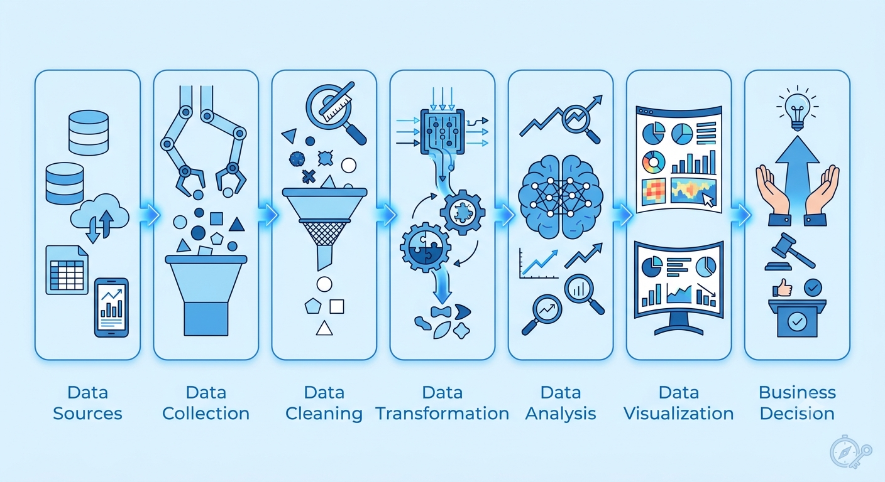
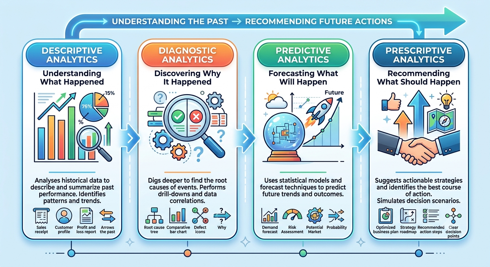
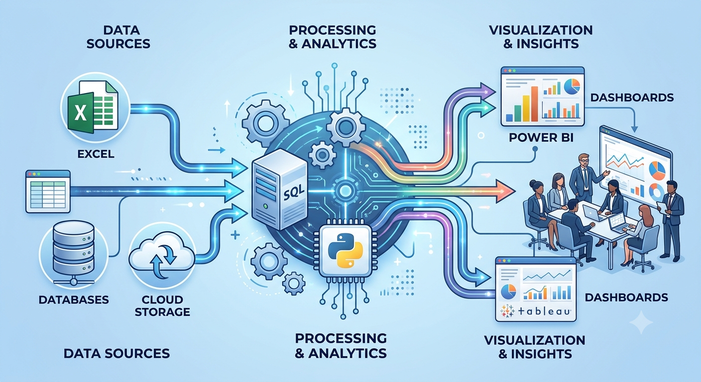

# What Is Data Analytics?

Imagine you're the captain of a cricket team.

Your team has lost five matches in a row.

Everyone has an opinion.

- "The batting is weak."
- "The bowling is the problem."
- "The pitch wasn't good."

But opinions don't win championships.

**Data does.**

Now imagine someone shows you:

- Every player's scoring pattern.
- Which bowlers struggle in the final overs.
- Which stadium gives your team the highest win rate.
- The batting order that produces the best results.

Suddenly, you're no longer guessing.

You're making decisions backed by evidence.

That's exactly what **Data Analytics** is.

It helps people and businesses make smarter decisions by turning raw data into meaningful insights.

---

## What Is Data?

Before understanding Data Analytics, let's understand **data**.

### Simple Explanation

Data is **raw information**.

### Professional Explanation

Data consists of facts, measurements, observations, or records collected from various sources. On its own, data has little meaning until it is processed and analyzed.

### Example

| Customer | Product | Price |
|-----------|---------|------|
| Ali | Milk | ₹60 |
| Sara | Bread | ₹45 |
| John | Eggs | ₹90 |

This table is data.

---

## What Is Analytics?

Analytics is the process of discovering useful patterns, trends, and insights from information.

Imagine reading thousands of shopping receipts.

Instead of checking each receipt manually, analytics answers questions like:

- Which product sells the most?
- Which day has the highest sales?
- Which customers return frequently?
- Which products should be promoted?

Analytics transforms information into knowledge.

---

## Data + Analytics = Data Analytics

Data Analytics is the process of collecting, cleaning, transforming, analyzing, and visualizing data to make better decisions.

Think of it like cooking.

| Cooking | Data Analytics |
|----------|----------------|
| Ingredients | Raw Data |
| Washing Vegetables | Data Cleaning |
| Recipe | Analysis Method |
| Cooking | Data Processing |
| Taste Testing | Validation |
| Serving Food | Dashboard or Report |
| Happy Customer | Better Business Decision |

Raw vegetables are not dinner.

Raw data is not insight.

---

## Why Does Data Analytics Matter?

Every day we generate data by:

- Shopping online
- Watching YouTube
- Using Google Maps
- Paying bills
- Visiting hospitals
- Using social media

Collecting data is easy.

Understanding it is where Data Analytics creates value.

> **Did You Know?**
>
> Companies like Amazon, Netflix, Uber, Google, and Spotify rely heavily on Data Analytics to improve customer experiences and business decisions.

---

## Real-World Examples

### Netflix

Netflix analyzes your watch history, ratings, and viewing habits to recommend movies and TV shows you'll probably enjoy.

### Amazon

Amazon studies customer purchases, searches, and browsing behavior to recommend products and manage inventory.

### Uber

Uber combines traffic conditions, weather, rider demand, and driver availability to calculate fares and estimate arrival times.

### Hospitals

Hospitals analyze patient records to predict health risks, improve treatment plans, and reduce waiting times.

---

## The Data Analytics Process

Every analytics project typically follows these five steps:

1. Collect Data
2. Clean Data
3. Transform Data
4. Analyze Data
5. Visualize Results

Each step improves the quality of insights and supports better decision-making.

---

## The Four Types of Data Analytics

| Type | Question It Answers |
|------|----------------------|
| Descriptive | What happened? |
| Diagnostic | Why did it happen? |
| Predictive | What is likely to happen? |
| Prescriptive | What should we do? |

### Descriptive Analytics

Summarizes historical data.

**Example:** Monthly sales report.

### Diagnostic Analytics

Finds the reason behind a problem.

**Example:** Why did sales decrease last month?

### Predictive Analytics

Uses historical data to forecast future outcomes.

**Example:** Predicting customer churn.

### Prescriptive Analytics

Recommends the best action to take.

**Example:** Suggesting the best discount strategy to maximize profit.

---

## Popular Data Analytics Tools

| Tool | Primary Use |
|------|--------------|
| Excel | Data Cleaning & Analysis |
| SQL | Querying Databases |
| Python | Automation & Advanced Analytics |
| R | Statistical Analysis |
| Power BI | Dashboards |
| Tableau | Data Visualization |
| Looker Studio | Reporting |
| Snowflake | Cloud Data Warehouse |

---

## Common Beginner Mistakes

- Learning Python before mastering Excel and SQL.
- Ignoring data cleaning.
- Building dashboards without understanding the business problem.
- Focusing on tools instead of solving real problems.

---

## Data Analytics vs Data Science

| Data Analytics | Data Science |
|----------------|--------------|
| Focuses on insights | Focuses on prediction and machine learning |
| Heavy use of SQL | Heavy use of programming |
| Business-oriented | Algorithm-oriented |
| Easier entry point | More mathematical |

---

## Key Takeaways

- Data is raw information.
- Analytics extracts meaningful insights from data.
- Data Analytics helps people make better decisions.
- The process includes collecting, cleaning, transforming, analyzing, and visualizing data.
- Excel, SQL, Python, and Power BI are the most common beginner tools.

---

## Frequently Asked Questions

### Is Data Analytics difficult?

No. Anyone can learn it step by step with consistent practice.

### Do I need coding?

No. Many beginners start with Excel before learning SQL and Python.

### Is Data Analytics a good career?

Yes. It is one of the fastest-growing careers across healthcare, finance, retail, marketing, manufacturing, and technology.

---

## Conclusion

Every business today generates enormous amounts of data.

The companies that succeed aren't the ones with the most data—they're the ones that know how to use it.

Learning Data Analytics isn't just about using tools like Excel, SQL, or Power BI. It's about asking the right questions, solving real business problems, and making confident decisions based on evidence instead of assumptions.

In the next article, we'll explore **The Complete Data Analytics Process** and see how raw data becomes actionable business insights.