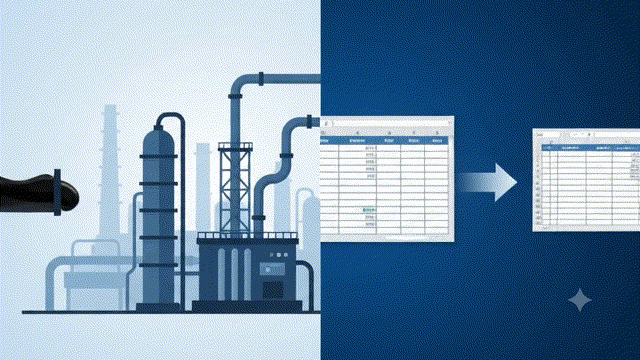

# Why Companies Pay Data Analysts: The Hidden Business Value Behind Every Decision

Imagine you're the owner of a supermarket.

Every day, thousands of customers walk through your doors.

They buy groceries, snacks, drinks, vegetables, cosmetics, and household products.

Your billing software records everything.

At the end of the month, you have millions of rows of data.

But here's the question.

**Do you actually know what that data is trying to tell you?**

- Which products should you stock more?
- Why did sales suddenly drop last Tuesday?
- Which customers are likely to stop coming?
- Should you open another branch?
- Are your discounts increasing profit—or destroying it?

Your computer has all the data.

Yet it cannot answer these questions on its own.

That's where a Data Analyst becomes valuable.

Companies don't pay Data Analysts because they have data.

They pay them because they need **better decisions.**

By the end of this article, you'll understand why organizations around the world—from small startups to companies like Amazon and Netflix—invest millions every year in Data Analysts.

And you'll never look at the profession the same way again.

---

## Every Company Has Data

Whether it's a hospital, bank, school, restaurant, online store, or cricket team, every organization generates data every single day.

Some examples include:

- Customer purchases
- Employee attendance
- Website visitors
- Mobile app usage
- Product reviews
- Delivery times
- Inventory levels
- Marketing campaigns
- Financial transactions

The bigger the company, the more data it creates.

Some organizations generate terabytes of data every day.

But having data doesn't automatically make a company smarter.

In fact...

Most businesses are drowning in data while starving for insights.

> **Did You Know?**
>
> It's estimated that over 90% of the world's digital data has been created in just the past few years. Yet much of it is never analyzed for decision-making.

So why can't companies simply use software to understand everything automatically?

That's where the real challenge begins.

---

## Data Is Like Crude Oil

People often say:

> **"Data is the new oil."**

At first, that sounds strange.

How can numbers be compared to oil?

Here's why.

Crude oil coming out of the ground isn't very useful.

It must first be refined.

Only then does it become petrol, diesel, jet fuel, or other valuable products.

Data works exactly the same way.

Raw data is simply a collection of numbers, text, dates, and records.

It becomes valuable only after someone transforms it into meaningful information.

### Simple Explanation

Raw data tells you **what happened**.

Analysis tells you **why it happened and what to do next.**

### Professional Explanation

Data analysis involves cleaning, organizing, exploring, and interpreting data to identify meaningful patterns that support informed business decisions.

### Real-World Example

Imagine an e-commerce website receives:

- 500,000 visitors
- 18,000 orders

Without analysis, those are just numbers.

A Data Analyst discovers that:

- Most visitors leave on the payment page.
- Mobile users abandon carts twice as often as desktop users.
- One payment method frequently fails.
- Fixing that issue could increase revenue by 12%.

The data didn't change.

The understanding did.

And that understanding is what companies pay for.

---

## Why Software Alone Isn't Enough

Many beginners ask:

> "If companies already have dashboards and AI tools, why hire Data Analysts?"

It's a great question.

The answer is simple.

Software can calculate.

Humans decide.

Imagine a dashboard shows:

- Sales dropped by 18%.

The dashboard tells you **what happened.**

But it doesn't necessarily explain:

- Was it because of a competitor?
- A pricing change?
- A marketing failure?
- Bad weather?
- A supply chain issue?
- A website bug?

A Data Analyst investigates the evidence, connects different pieces of information, and uncovers the real story.

That's something software alone often cannot do.

Think of software as a calculator.

A calculator gives the correct answer.

But it doesn't know which question you should ask.

A Data Analyst does.

---

## The Real Job Companies Are Paying For

Many people believe Data Analysts spend their entire day making charts.

That's only a small part of the job.

Companies aren't paying for charts.

They're paying for **better decisions.**

A Data Analyst helps answer questions like:

- Which product should we discontinue?
- Where should we invest next?
- Which customers are leaving?
- How can we reduce costs?
- Which marketing campaign actually works?
- Should we hire more employees?
- Why are customers complaining?

Every answer affects money.

Sometimes thousands of rupees.

Sometimes crores.

Sometimes billions.

That makes good analysis incredibly valuable.

---

## Imagine Driving With Your Eyes Closed

Think about driving a car.

Would you drive without looking through the windshield?

Of course not.

You'd probably crash within minutes.

Running a business without data analysis is surprisingly similar.

Managers make hundreds of decisions every day.

Without reliable insights, those decisions become guesses.

Sometimes guesses work.

Most of the time, they don't.

A Data Analyst acts like the windshield for a business.

They help leaders see what's happening before making important decisions.

And better visibility usually leads to better results.

---

## Real Companies That Depend on Data Analysts

Let's look at some well-known examples.

### Amazon

Amazon studies customer behavior to recommend products, manage inventory, improve delivery times, and optimize pricing.

Behind many of these decisions are teams of analysts.

### Netflix

Netflix analyzes viewing habits to recommend movies and TV shows you'll probably enjoy.

It also uses analytics to decide which original shows to produce.

### Uber

Uber analyzes demand, traffic, weather, and driver availability to calculate dynamic pricing.

### Starbucks

Starbucks uses location analytics before opening new stores.

It studies demographics, nearby businesses, traffic patterns, and customer behavior.

These companies don't hire analysts because it's trendy.

They hire them because better decisions create better businesses.

---

## Myth vs Fact

| Myth | Fact |
|-------|------|
| Data Analysts only create reports. | Reports are only one part of their work. |
| Excel is enough. | Modern analysts use SQL, Python, Power BI, Tableau, and cloud platforms. |
| AI will replace Data Analysts. | AI assists analysts, but businesses still need humans to ask the right questions and interpret results. |
| Only tech companies hire analysts. | Almost every industry now relies on data-driven decision making. |

---

## Quick Summary

By now you've learned that:

- Every company generates data.
- Raw data has little value by itself.
- Data must be transformed into insights.
- Software provides numbers.
- Analysts provide understanding.
- Better understanding leads to better business decisions.
- Better decisions increase profits and reduce risks.

But here's something even more interesting.

We've mostly talked about **why** companies hire Data Analysts.

We haven't explored **how** analysts actually make companies more money.

And that's where the real magic begins...

In the next chapter, you'll discover how a single Data Analyst can save a company millions of rupees, increase profits, reduce costs, improve customer satisfaction, and influence decisions across marketing, finance, HR, operations, and product teams.

You'll finally understand why experienced analysts are considered one of the highest-value professionals inside modern businesses.